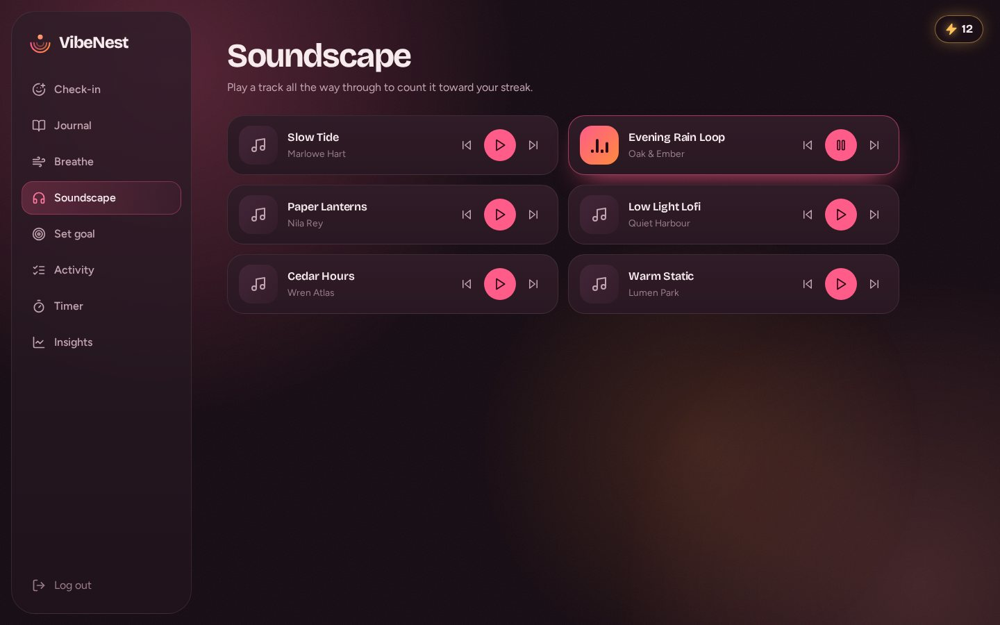
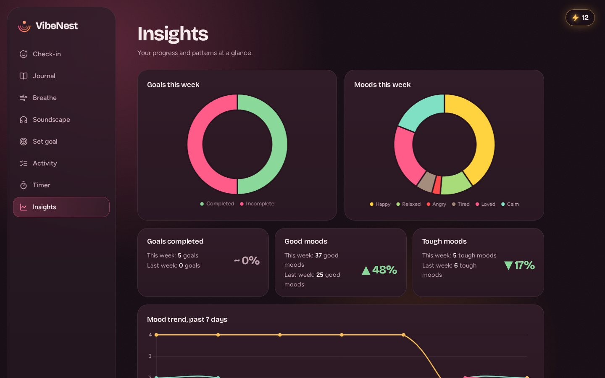
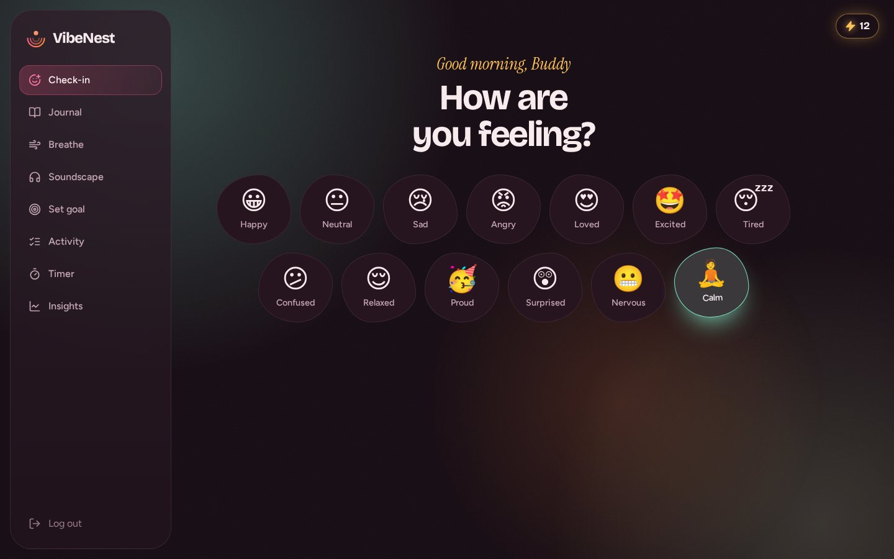
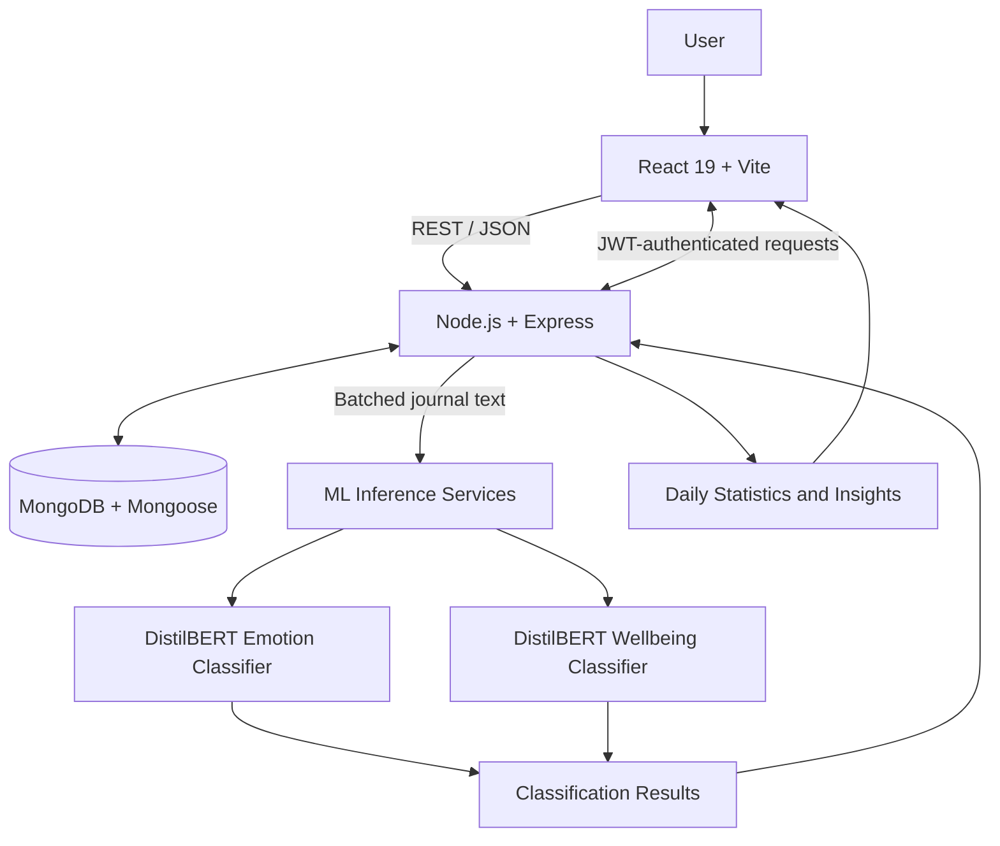

 <div align="center">


### Your feelings. Your space. Your journey.

*A full-stack wellness companion that brings mood tracking, mindful journaling, guided breathing, calming soundscapes, personal goals, and AI-powered emotional insights together in one thoughtfully designed space.*

<p>
  
  
  
  
  
</p>

<p>
  <a href="https://github.com/TarlanaVikas/VibeNest">Repository</a> ·
  <a href="#features">Features</a> ·
  <a href="#architecture">Architecture</a> ·
  <a href="#getting-started">Getting Started</a> ·
  <a href="#api-reference">API Reference</a>
</p>

</div>

---

## Table of Contents

- [About VibeNest](#about-vibenest)
- [Why VibeNest?](#why-vibenest)
- [Features](#features)
- [Application Preview](#application-preview)
- [Architecture](#architecture)
- [Technology Stack](#technology-stack)
- [Project Structure](#project-structure)
- [Machine Learning Pipeline](#machine-learning-pipeline)
- [API Reference](#api-reference)
- [Design System](#design-system)
- [Getting Started](#getting-started)
- [Environment Configuration](#environment-configuration)
- [Security and Privacy](#security-and-privacy)
- [Future Enhancements](#future-enhancements)
- [Disclaimer](#disclaimer)

---

## About VibeNest

VibeNest is a full-stack wellness and self-reflection application designed to make everyday emotional awareness feel natural, personal, and accessible.

Instead of treating wellbeing as another task on a checklist, VibeNest creates a calming digital space where users can check in with their emotions, put their thoughts into words, take mindful breaks, discover soothing sounds, and build small, sustainable habits.

Its machine learning pipeline analyses journal text using two DistilBERT-based classifiers to identify emotional signals and broader wellbeing-related categories. These results complement the user's personal reflections and contribute to their daily statistics and insights.

The experience is wrapped in an immersive, dark interface inspired by warm wine tones, soft rose highlights, and golden ambient light.

**The idea is simple: understand how you feel, make space for yourself, and notice the little things that change over time.**

## Why VibeNest?

- **Emotional awareness:** Record your mood and explore how it changes over time.
- **Mindful routines:** Make room for breathing exercises, calming audio, and focused breaks.
- **Personal reflection:** Maintain a journal and revisit your previous entries.
- **Small, meaningful goals:** Turn intentions into manageable daily activities.
- **Data-informed insights:** Explore mood distributions, weekly trends, goal completion, and listening habits.
- **ML-assisted journaling:** Use text classification to surface emotional and wellbeing-related signals.
- **A cohesive experience:** Bring everyday wellness activities together in one personalized dashboard.

## Features

### 1. Mood Check-In

- Choose from 13 available moods.
- Add a note to capture what influenced your feelings.
- Maintain a record of daily emotional check-ins.
- Connect mood entries with daily statistics and streak tracking.
- Use mood-specific colours to create a more expressive interface.

### 2. Reflective Journal

- Write personal thoughts in a dedicated journal interface.
- Revisit recent entries and reflect on previous experiences.
- Analyse journal text using two DistilBERT-based classifiers.
- Surface emotion labels and wellbeing-related signals from written reflections.
- Incorporate analysed results into the application's broader insight experience.

### 3. Guided Breathing

- Choose a 5, 10, 15, or 20-minute session.
- Follow a guided 12-second inhale/exhale cycle.
- Experience a calming visual environment while breathing.
- Enable optional ambient audio.
- Use a green ambient state to distinguish breathing sessions from the rest of the interface.

### 4. Calming Soundscape

- Explore a library of calming audio tracks.
- Listen to sounds designed to support relaxation and focus.
- Track completed listening activity through the application.
- View personal listening statistics in Insights.

### 5. Focus and Rest Timer

- Run dedicated focus or rest sessions.
- Monitor progress through a circular progress indicator.
- Pause or stop a session when needed.
- Enable optional ambient audio.

### 6. Goals and Activities

- Create personal goals with an emoji and due date.
- Mark goals as completed.
- Review recent, pending, and overdue goals.
- Explore suggested activities.
- Track goal completion as part of the broader wellness journey.

### 7. Insights Dashboard

Turn everyday check-ins into a clearer picture of your habits and emotions.

- Weekly goal-completion statistics.
- Mood distribution visualisations.
- Week-over-week comparisons.
- Seven-day mood trends.
- Most-listened-to tracks.
- Daily reflection support.

### 8. Streak Tracking

- Maintain a running activity streak.
- Encourage consistency through visible progress.
- Connect regular check-ins and tracked activities with a sense of continuity.

### 9. Authentication

- Email and password registration.
- Login and session handling using JSON Web Tokens.
- Password hashing using bcrypt.
- Protected endpoints for authenticated user activities.

---

## Application Preview

### Soundscape

<p align="center">
  
</p>

### Insights and Mood Check-In

<p align="center">
  
  
</p>

*Screenshots are stored in `frontend/public/images/`.*

---

## Architecture

VibeNest separates the user interface, application API, persistent data, and machine learning inference into distinct components.



### Request and Data Flow

1. **User interaction:** Users interact with the React single-page application.
2. **API communication:** The frontend communicates with Express endpoints using REST requests and JSON.
3. **Authentication:** JWT bearer tokens are used for authenticated operations.
4. **Persistence:** Mongoose models manage application data stored in MongoDB.
5. **Journal analysis:** When a journal entry is saved, its text is segmented and sent in a batch to the two classification services.
6. **Inference:** The emotion classifier predicts emotion labels, while the wellbeing classifier predicts categories defined by its trained label set.
7. **Insight generation:** Classification results and recorded activities contribute to the application's daily statistics and visualisations.

---

## Technology Stack

| Layer | Technologies | Purpose |
|---|---|---|
| Frontend | React 19, Vite | Component-based single-page application |
| Routing | React Router | Navigation between application pages |
| Visualisation | Chart.js | Mood, activity, and progress charts |
| Icons | React Icons | Interface iconography |
| Styling | Custom CSS | Responsive layouts and design tokens |
| Backend | Node.js, Express | REST API and application logic |
| Database | MongoDB, Mongoose | Persistent application data |
| Authentication | JWT, bcrypt | Token-based sessions and password hashing |
| HTTP client | Axios | Requests to ML inference endpoints |
| NLP | DistilBERT | Emotion and wellbeing-related text classification |

---

## Project Structure

```text
VibeNest/
│
├── frontend/
│   ├── public/
│   │   ├── favicon.svg
│   │   └── images/
│   │       ├── soundscape.jpg
│   │       ├── insights.jpg
│   │       └── checkin.jpg
│   │
│   └── src/
│       ├── pages/
│       │   ├── Welcome
│       │   ├── Cover
│       │   ├── Login
│       │   ├── Signup
│       │   └── Main shell
│       │
│       ├── feature/
│       │   ├── Check-in
│       │   ├── Journal
│       │   ├── Breathe
│       │   ├── Soundscape
│       │   ├── Timer
│       │   ├── Goals
│       │   ├── Activity
│       │   └── Insights
│       │
│       ├── components/
│       │   └── Shared UI, cards, charts and forms
│       ├── theme/
│       │   └── Mood palette and chart theme
│       ├── styles/
│       │   └── Design tokens and component styles
│       └── config.js
│
├── backend/
│   └── src/
│       ├── routes/
│       │   └── Express route modules
│       ├── controllers/
│       │   └── Authentication and user controllers
│       ├── models/
│       │   └── Mongoose schemas
│       ├── middleware/
│       │   └── JWT authentication middleware
│       └── config/
│           └── Database connection
│
└── ml-services/
    ├── emotion_model_v2/
    │   └── Emotion model configuration and tokenizer
    └── mental_health_model/
        └── Wellbeing model configuration and tokenizer
```

### Directory Guide

| Directory | Responsibility |
|---|---|
| `frontend/src/pages/` | Entry pages, login, signup, and the main application shell |
| `frontend/src/feature/` | Individual wellness features and their interfaces |
| `frontend/src/components/` | Reusable interface components |
| `frontend/src/theme/` | Mood colour mappings and chart theming |
| `frontend/src/styles/` | Global design tokens and component styles |
| `backend/src/routes/` | HTTP route definitions |
| `backend/src/controllers/` | Request handling and application logic |
| `backend/src/models/` | Database schemas and models |
| `backend/src/middleware/` | Authentication and request middleware |
| `backend/src/config/` | Database connection configuration |
| `ml-services/` | Model configurations, tokenizers, and classifier assets |

---

## Machine Learning Pipeline

VibeNest uses two DistilBERT-based sequence classifiers to analyse journal text.

### Emotion Classification

The emotion classifier assigns each processed text segment to one of six labels:

`Sadness` · `Joy` · `Love` · `Anger` · `Fear` · `Surprise`

### Wellbeing Classification

The second classifier predicts one of seven categories associated with the model's wellbeing-related label set. The most frequent predicted label is retained as a signal for the journal entry.

### Processing Workflow

```text
Journal Entry
     |
     v
Text Segmentation
     |
     v
Batch Inference
     |
     +--------------------------+
     |                          |
     v                          v
Emotion Classifier       Wellbeing Classifier
     |                          |
     v                          v
Emotion Labels            Category Predictions
     |                          |
     +------------+-------------+
                  |
                  v
       Processed Journal Signals
                  |
                  v
       Daily Stats and Insights
```

The classification results are intended to support personal reflection, not to determine a person's mental health status.

---

## API Reference

All endpoints are prefixed with `/api`.

**Authentication notation:** 🔒 indicates routes that require a bearer token, according to the supplied API inventory.

| Area | Method | Endpoint | Purpose |
|---|---|---|---|
| Authentication | POST | `/auth/signup` | Register an account |
| Authentication | POST | `/auth/check-email` | Check email availability |
| Authentication | POST | `/auth/login` | Authenticate a user |
| Users | GET | `/users/:loginId` | Retrieve user information |
| Users | PUT | `/users/:loginId` | Update user information |
| Mood | POST 🔒 | `/feelingentries` | Create a mood check-in |
| Mood | GET 🔒 | `/feelingentries/recent` | Retrieve recent check-ins |
| Daily Stats | GET 🔒 | `/dailystats/:date` | Retrieve statistics for a date |
| Daily Stats | POST 🔒 | `/dailystats/update` | Update daily statistics |
| Daily Stats | GET 🔒 | `/dailystats/recent` | Retrieve recent statistics |
| Daily Stats | GET 🔒 | `/dailystats/last` | Retrieve the latest statistics |
| Journal | POST 🔒 | `/journal` | Save a journal entry |
| Journal | GET 🔒 | `/journal/recent` | Retrieve recent entries |
| Goals | POST 🔒 | `/goals` | Create a goal |
| Goals | GET 🔒 | `/goals` | Retrieve goals |
| Goals | GET 🔒 | `/goals/recent` | Retrieve recent goals |
| Goals | GET 🔒 | `/goals/pending` | Retrieve pending goals |
| Goals | GET 🔒 | `/goals/overdue` | Retrieve overdue goals |
| Goals | PUT 🔒 | `/goals/:id/complete` | Complete a goal |
| Activities | GET | `/activities` | Retrieve activities |
| Activities | GET | `/activities/suggest` | Retrieve suggested activities |
| Activities | POST | `/activities` | Create an activity |
| Reflections | POST 🔒 | `/reflections` | Save a reflection |
| Reflections | GET 🔒 | `/reflections/recent` | Retrieve recent reflections |
| Soundscape | GET 🔒 | `/soundscape/tracks` | Retrieve tracks |
| Soundscape | POST 🔒 | `/soundscape/:trackId/listen` | Record listening activity |
| Soundscape | GET 🔒 | `/soundscape/user/listens` | Retrieve personal listens |
| Soundscape | POST 🔒 | `/soundscape/add` | Add a soundscape track |
| Timer Audio | GET | `/timeraudio` | Retrieve timer audio |
| Timer Audio | GET | `/timeraudio/:name` | Retrieve a named audio resource |
| Timer Audio | POST | `/timeraudio/add` | Add timer audio |
| Streak | GET 🔒 | `/streak` | Retrieve streak information |
| Streak | POST 🔒 | `/streak/update` | Update streak information |

*This reference reflects the supplied route inventory. Check the backend implementation for exact request schemas, response formats, and route-level access controls.*

---

## Design System

VibeNest uses a warm, low-light visual language inspired by a quiet personal space rather than a conventional dashboard.

| Design token | Hex value | Application |
|---|---|---|
| Night | `#150B12` | Main background |
| Surface | `#26141F` | Cards and panels |
| Ink | `#F8EBEE` | Primary text |
| Rose | `#FF5C8A` | Actions and focus states |
| Honey | `#FFC25A` | Streaks and highlights |
| Ember | `#FF8A3D` | Secondary accent |
| Mint | `#7FE0C3` | Calm and breathing states |

### Visual Principles

- **Mood-responsive colour:** Mood-specific colours influence relevant interface elements and ambient lighting.
- **Soft ambient glow:** Background lighting creates a sense of depth without overwhelming content.
- **Typography with character:** Bricolage Grotesque for display text, Figtree for interface elements, and Instrument Serif for writing.
- **Custom styling:** A design-token system and hand-written CSS maintain consistency without a UI framework.
- **Responsive layouts:** The interface adapts to phone and desktop screen sizes.
- **Accessible motion:** Animations respect the `prefers-reduced-motion` preference.
- **Keyboard navigation:** Interactive elements are designed to be keyboard reachable.

---

## Getting Started

### Prerequisites

Install the following before running the application:

- Node.js and npm
- MongoDB, either a local instance or a hosted database
- Python and the dependencies required by your ML inference setup, if running the classifiers locally

### 1. Clone the repository

```bash
git clone https://github.com/TarlanaVikas/VibeNest.git
cd VibeNest
```

### 2. Set up the frontend

```bash
cd frontend
npm install
npm run dev
```

Vite will display the local development URL in your terminal.

### 3. Set up the backend

Open a separate terminal:

```bash
cd backend
npm install
```

Configure the backend environment variables and then start the server using the script defined in `backend/package.json`.

For example, if the project defines a `dev` script:

```bash
npm run dev
```

### 4. Configure the ML services

Review the model configuration and tokenizer assets under `ml-services/`. Configure the inference service URLs and start the relevant services using their actual entry points and dependency files.

**Important:** The exact backend startup command, environment variable names, ML service ports, and inference launch commands should match the scripts and configuration present in the repository.

---

## Environment Configuration

Keep credentials and deployment-specific values in environment files rather than hardcoding them into application source code.

Depending on the existing configuration, you may need values for:

| Configuration | Purpose |
|---|---|
| MongoDB connection URI | Connect the backend to the database |
| JWT secret | Sign and validate authentication tokens |
| Frontend API base URL | Point the frontend to the backend |
| ML inference endpoints | Allow the backend to reach the classifiers |

Use the actual environment variable names referenced in your source code. Do not commit secrets, production credentials, or private connection strings to GitHub.

---

## Security and Privacy

VibeNest handles personal journal entries and emotional reflections, so privacy and responsible data handling are important.

- Passwords are hashed using bcrypt.
- JWT-based authentication supports protected API operations.
- Environment variables should hold secrets and connection credentials.
- Database access should follow appropriate authentication and access-control rules.
- Journal text and model outputs should be handled as sensitive personal information.
- Production deployments should use HTTPS and appropriate access controls.
- Authentication, authorisation, validation, and error handling should be verified before deployment.

Security controls should be tested against the actual implementation rather than assumed from the presence of a particular library.

---

## Future Enhancements

Potential areas for future development include:

- **Long-term mood patterns:** Explore longer time ranges and recurring trends.
- **Personalised routines:** Suggest activities based on user preferences and recorded habits.
- **Enhanced journaling:** Add optional prompts and structured reflection exercises.
- **Data portability:** Allow users to export or delete their personal records.
- **Improved model evaluation:** Measure classifier performance, calibration, and limitations across diverse writing styles.
- **Deployment automation:** Add automated testing and CI/CD workflows.
- **Accessibility improvements:** Continue refining keyboard navigation, contrast, and reduced-motion support.

These are possible extensions, not claims about features already implemented.

---

## Disclaimer

VibeNest is a self-reflection and wellness companion. Its machine learning outputs are informational signals, not clinical assessments, diagnoses, or treatment recommendations.

The application is not a substitute for qualified mental health care. If you are experiencing persistent distress or need support, consider reaching out to a qualified professional or someone you trust.

---

<div align="center">


**VibeNest — Make space for yourself.**

*Check in. Slow down. Reflect. Grow.*

</div>
